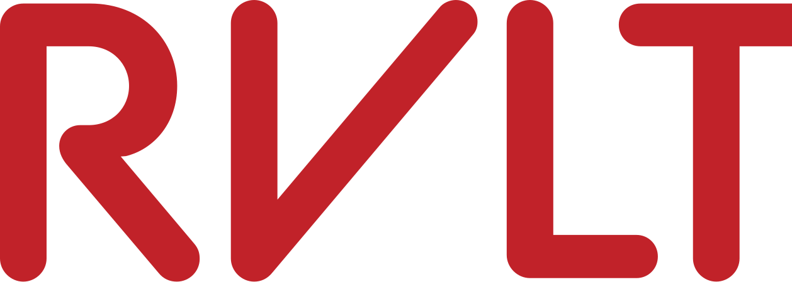
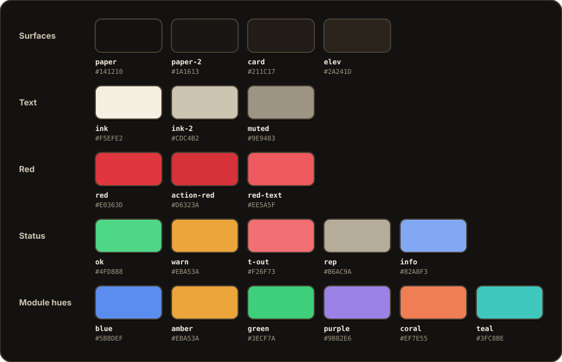
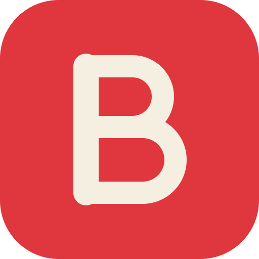
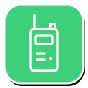
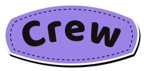

  <picture>
    <source media="(prefers-color-scheme: dark)" srcset="design-system/assets/Logos/rvlt-labs-logo.svg">
    
  </picture>

# RVLT design language

The brand and design system for **RVLT Labs** and every RVLT product: **RVLT Flow** (production
operations), **RVLT Binder** (the stage manager's script binder) and **Pulse, by RVLT** (live
audio and wireless monitoring). RVLT Labs was born inside Two
Toned Productions; the system is built for production companies, by a production company. This
repository is the **master copy**. The products and the claude.ai design-system artifact sync from it.

- **The spec:** [`DESIGN.md`](DESIGN.md) is the build bible. Agents read §0 first.
- **Which source wins:** [`docs/AUTHORITY.md`](docs/AUTHORITY.md) (machine copy: [`authority.json`](authority.json)).
- **Browse it:** the published reference at
  [rvlt-labs.github.io/rvlt-designlanguage](https://rvlt-labs.github.io/rvlt-designlanguage/)
  ([`index.html`](index.html)), with the component gallery at `/design-system/`.

## Authority

One map decides which source wins, highest first:

1. **Normative RVLT rules**: `DESIGN.md` §0 to §18.
2. **Product contracts**: `DESIGN.md` §19 (Flow, Binder and Pulse, and only the differences recorded there).
3. **Canonical machine tokens**: `packages/flow-theme/tokens.json` and `contrast.json`. Appendix A,
   §15.1 and `design-system/tokens.json` are checked mirrors.
4. **Implementation**: the `@rvlt/flow-theme` registry, the public component contract.
5. **Verified examples**: `examples/`, `apps/preview-v2` and the design-system cards, all built and
   tested. Live cards render the Flow and Binder app adapters at pinned commits and say so.
6. **Marketing expression**: [`examples/flow-marketing/`](examples/flow-marketing/). Marketing
   never wins a conflict, and its figures are illustrative.

## Foundations

- **Dark first.** Espresso (`--paper #141210`) is the primary surface; Paper (light) is the opt-in
  alternate. Tint the dark warm, never cold slate or pure black.
- **The dial.** Marketing sits at the expressive end (stickers, big display type, doodles, the
  spotlight). Apps sit at the functional end: **calm data, fun chrome**.
- **The spotlight rule.** About 90% of a dark viewport stays in the espresso ramp; brightness is
  spent as at most three lit objects per page (two on a phone).
- **Physical edges.** A 2px outline plus a hard offset shadow, never a soft blur.
- **One red.** RVLT red is the only accent: primary action, live state, alerts. Never decoration,
  never a module, avatar, department or chart colour.
- **Voice.** A production manager, not a marketer. Trade words, concrete numbers, dry wit, no fake
  proof.

## Tokens

[`packages/flow-theme/tokens.json`](packages/flow-theme/tokens.json) holds every value: the two
themes, radii, fonts, the marketing type scale and the app type ramp, icon sizes, the avatar and
chart order, and the rules. [`contrast.json`](packages/flow-theme/contrast.json) lists which token
may draw text, pills, fills and control boundaries on which surface; every pairing meets WCAG AA in
both themes and there are no accepted exceptions (`DESIGN.md` §3.8).

| Role | Espresso | Paper |
|---|---|---|
| Surfaces `paper` · `paper-2` · `card` · `elev` | `#141210` · `#1A1613` · `#211C17` · `#2A241D` | `#F4EEE1` · `#EDE4D2` · `#FFFDF8` · `#FFFDF8` |
| Text `ink` · `ink-2` · `muted` | `#F5EFE2` · `#CDC4B2` · `#9E9483` | `#1D1A15` · `#4B4539` · `#665E4F` |
| Core red (mark, rings, strokes) | `#E0363D` | `#C12229` |
| Action red (white-text fills) | `#D6323A` | `#C12229` |
| Red words | `#EE5A5F` | `#C12229` |
| Control boundary (`--input`) | `#857A69` | `#1D1A15` |
| `faint` (non-text only) | `#6E665A` | `#756B58` |

<picture>
  <source media="(prefers-color-scheme: light)" srcset="docs/brand/palette-light.svg">
  
</picture>

The palette follows your GitHub theme: Espresso in dark mode, Paper in light. It is generated from
`tokens.json` by `scripts/site/readme-brand.mjs`.

Install the generated theme with `@import "@rvlt/flow-theme/globals.css"`; see
[`packages/flow-theme/README.md`](packages/flow-theme/README.md).

## Typography

Five SIL OFL families, self-hosted in [`design-system/fonts/`](design-system/fonts) and shipped
as `@rvlt/flow-theme/fonts.css`:

| Family | Role |
|---|---|
| **Archivo** | Display: headlines, page titles (24px / 800 in every app), stat figures |
| **Hanken Grotesk** | Body and UI |
| **Geist Mono** | Data: IDs, quantities, times, cue and page numbers, always tabular |
| **Kalam** | Handwritten eyebrows and doodle notes only, sentence case |
| **Baloo 2** | The "Flow" half of the lockup only |

BC Alphapipe survives only as the drawn RVLT mark (SVG outlines), never as a loaded font. Sentence
case everywhere; nothing below 11px; reading body at 16px or more.

## Identity and assets

| RVLT Labs | RVLT Flow | RVLT Binder | Pulse, by RVLT |
|:---:|:---:|:---:|:---:|
| <picture><source media="(prefers-color-scheme: dark)" srcset="design-system/assets/Logos/rvlt-labs-logo.svg"></picture> | <picture><source media="(prefers-color-scheme: dark)" srcset="design-system/assets/Logos/rvlt-flow-wordmark-dark.svg"></picture> |  |  |

  
  
  
  
  

  
  
  
  

- **Marks:** [`design-system/assets/Logos/`](design-system/assets/Logos): `rvlt-mark.svg`,
  `rvlt-labs-logo.svg`, the Flow wordmarks, R marks, Binder's Rings B and Flow's mascot. Ship as
  SVG; never retype, recolour or redraw.
- **Stickers and wordmarks pack 1.1.0:** [`assets/stickers/`](assets/stickers) (19 gear
  illustrations, 7 phrase patches, style guide, licences; `DESIGN.md` §10).
- **Albert**, RVLT's character: [`assets/albert/`](assets/albert) (SVGs, the three locked
  illustrations pinned in `Design-lock.json`, the workday set; `DESIGN.md` §11).
- **Icons:** Lucide at 16 / 20 / 24px, 2px stroke; the 42px patch icon at 2.6px.
- **Light and dark grounds:** RVLT LABS (white LABS) and the dark Flow wordmark are for dark
  grounds only. The images above switch with your GitHub theme rather than recolouring a mark.

The packs are supplied artwork. Use the files unchanged; never generate, redraw or recombine them.

## Components

- **Registry:** [`packages/flow-theme/registry/`](packages/flow-theme/registry), installed with
  the shadcn CLI. RVLT-styled primitives plus the signature set (lifecycle stepper, status
  indicator, crew scheduler with a phone agenda, empty state, feature patch, `SearchInput`).
- **Gallery:** [`design-system/components/`](design-system/components), live at
  `/design-system/` on the Pages site.
- **Reference compositions:** [`examples/flows/`](examples/flows) for scan and return, the
  offline queue, clash recovery, the responsive scheduler and accessible forms. Front-end
  only: no backend, no user testing claimed.
- **Static catalogue:** [`examples/static-catalogue/`](examples/static-catalogue) (plain
  HTML/CSS states; the old `/preview.html` redirects here).

## Product layers

- **RVLT Flow:** pill buttons, module hues for wayfinding (Projects blue, Assets amber, Crew
  purple, Schedule green, Maintenance coral, Warehouse teal), the stage-light mascot in empty
  states. `DESIGN.md` §19.1.
- **RVLT Binder:** rounded-rectangle buttons; the script page is always white paper in both
  themes; department colour is the only colour on the page and draws marks, not text; Markup and
  Calling draw the page identically. `DESIGN.md` §19.2.
- **Pulse, by RVLT:** dark only, for an A2 or A1 reading it for a second at a time. Red on a
  channel card means a critical fault and nothing else; live and listening are green; secondary
  controls are 1px lines with no offset shadow; no mascot or Kalam on live screens. The lockup is
  the five-bar glyph in cream on a red tile with a "by RVLT" pill. `DESIGN.md` §19.3.

## Using and building

The repository has no runtime dependencies at its root. Node 22.

| Command | What it does |
|---|---|
| `npm test` | Unit guards: token contrast, authority map, docs and examples parity, registry contracts, site links (builds the site into a temp folder) |
| `npm run test:browser` | Browser regressions against a built site (needs `RVLT_SITE_DIR` and Playwright from `tests/browser`) |
| `node packages/flow-theme/scripts/check-sync.mjs` | `tokens.json` equals `DESIGN.md` Appendix A |
| `node scripts/design-system/check.mjs` | The design-system mirror equals `tokens.json`; assets, fonts and cards resolve |
| `node scripts/site/readme-brand.mjs [--check]` | Regenerates (or checks) the README palettes in `docs/brand/` from `tokens.json` |
| `node packages/flow-theme/scripts/build-css.mjs` | Regenerates `dist/` (globals, tokens, font faces) from `tokens.json` |
| `npm ci --prefix apps/preview-v2` | Installs locked project-local build dependencies |
| `node scripts/design-system/bundle/build-registry.mjs` | Builds local Flow gallery JS and CSS using preview dependencies, required before unit site tests |
| `node scripts/site/build.mjs _site [--preview-v2 apps/preview-v2/out]` | Assembles the Pages site, including compatibility redirects |
| `GEARFLOW_DIR=… BINDER_DIR=… node scripts/design-system/bundle/build.mjs --write` | Rebuilds the Flow/Binder live bundle; writes only the generated bundle files |
| `PULSE_DIR=… node scripts/design-system/pulse/build.mjs --write` | Rebuilds the Pulse live bundle from a committed `qubered/a2-monitor` checkout (Vite borrowed from it); records the commit in the header and writes only `pulse-bundle.js` / `.css` |
| `node scripts/design-system/stage-artifact.mjs [_artifact]` | Stages `design-system/` as the artifact's `project/` folder, folding the Flow registry overlay into `bundle.js` / `bundle.css` (run `build-registry.mjs` first) |

Change the design system here first, then publish the staged `project/` files to the artifact
(pictures under `assets/` are asset-store uploads named in `design-system.json`). The Pages
workflow runs every check before it deploys.

© RVLT Labs. Built for production companies, by a production company.
